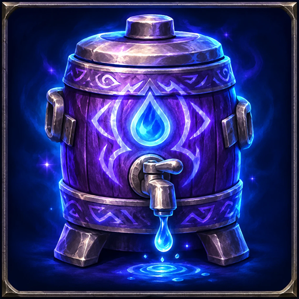

# Waterboy Reimagined



A WoW Forever addon for mages who hand out water.

- **Trades:** when someone opens a trade, it fills in the stacks of water and food their class wants, with
  per-player overrides.
- **Profiles:** a default profile, plus one per mage that overrides it (trades and loadouts).
- **Loadouts:** how much to keep in your bags solo, in a party and in a raid, and one macro that conjures
  whatever is missing and restacks.
- **Conjure now:** buttons beside the config window to cast your top two ranks of water and food once.
- **Drag-and-drop config** on a fake trade window.

What's planned next: see [Coming soon](#coming-soon).

## Why this addon

Back in vanilla, in 2005 and 2006, I played a mage and was my guild's waterboy, and I really liked the original
Waterboy addon. It fell out of support, and the addons that copied it later were missing features. Waterboy
Reimagined is strongly inspired by that first version and by my time handing out water to the guild, rebuilt for
WoW Forever.

It's an independent addon, not affiliated with the original Waterboy or its author.

## Coming soon

Planned, in no particular order:

- **Blocklist:** players who never get an automatic trade, whatever their class or setting. Not only for people
  you'd rather not serve: handy for levelling buddies who don't need your water.
- **Auto-fill by situation:** turn automatic trades on or off depending on where you are, e.g. on in cities and
  off in dungeons and raids.
- **Block levels:** choose how far a block goes: no automatic trade, no trade panel either, or decline their
  trades altogether.
- **Mana gems:** conjure mana gems with the macro and keep them in your loadout.
- **WoW Classic support:** the same addon on the Classic clients.
- **Vending machine:** a Vend mode with a minimum tip per stack. While the tip is too low, a stack comes back
  out of the trade every 3 seconds.
- **Your requests (maybe):** ideas are welcome as
  [GitHub issues](https://github.com/MatthewSokol/WaterboyReimagined/issues). No promises.

## Conjuring

The **Loadouts** tab of `/wbr` sets how many **stacks** to keep in your bags, per profile:

| Loadout | Default |
|---|---|
| Solo | 2 highest water, 1 highest food |
| Party | 2 highest water, 1 highest food **+ group's trades** |
| Raid | 8 highest water, 4 2nd-highest water, 2 highest food |

Columns are the highest and 2nd highest rank of water and food the mage knows. **+ group's trades** adds what
everyone in the group would get in a trade (their class or player setting) on top of the row's stacks.

**Macro:** click **Put macro on cursor** (or `/wbr macro`) to create the account macro "Waterboy" and drop it
on a bar. Its text, shown in the Loadouts tab, is:

```
/click WaterboyReimaginedConjure LeftButton 1
/click WaterboyReimaginedConjure
```

(Two lines so it works whether "cast on key down" is on or off.) Each press merges partial stacks, then casts
one conjure for the first thing you're short of: water before food, highest rank first. It says
`Casting water (rank 7)...` on the press, and once the cast finishes and the items land, how many stacks you
have of how many (plus "Loadout complete" when nothing is left). When everything's there a press just says the
loadout is complete. `/wbr loadout` prints the current targets. With no bag space for the next conjure, a
press casts nothing and says `Bags full: no room for water (rank 7)...`; if a conjure still adds nothing, it
says so.

The macro the button makes has a `#showtooltip` line that the addon keeps on the next conjure, so on your bar
it fades like that spell when you can't cast it (out of mana, say). Hovering it shows the spell, then the next
press and the loadout's stack counts. Pick its icon under **Macro icon** on the Loadouts tab: the glowing drop
(the default), an arcane water cooler, water buckets, or **Next conjure**, which shows the water or food spell the
next press casts. (If your client can't use the addon's own pictures for a macro, it shows the next conjure's
icon instead.)

**In combat** the addon can't re-aim the macro, so every press repeats whatever it was set to when combat
started; chat says so (`In combat: casting water (rank 7) again...`), and the loadout is rechecked when combat
ends.

**Conjure now:** on a mage, a small panel beside the `/wbr` window has a button each for your highest and
2nd highest water and food, with how many you're carrying. One click casts it once; it doesn't change your
loadout.

**Making more than the loadout:** press the macro 3 more times once the loadout is complete (it counts `Keep pressing to
override 1/3`, `2/3`) and it asks whether to keep making stuff in the same ratio:

- **Cancel:** nothing changes.
- **Temporary:** each press keeps conjuring extra rounds in the same ratio (loadout x2, then x3...). It stops
  once you go a minute without conjuring, and the macro goes back to your normal loadout.
  A small bar on screen counts the minute down ("Making extra (round 1): 0:47"); every conjure refills it.
  Drag it to move it, right-click it to stop early.
- **Update loadout:** opens the Loadouts tab on this character's profile to change the loadout by hand. That
  change is permanent (Use default undoes it).

## Trades

On a mage, when a trade opens the addon puts in the stacks set up for the other player. Each setting is up to
6 trade slots, each holding one rank of conjured water or food. If you have no stack of that rank, the next rank
down is used, then higher ranks.

With **Fill trades automatically** off (General tab of `/wbr`, or `/wbr off`), opening a trade on a mage shows a
panel next to the trade window instead: who you're trading with, which setting applies and its 6 slots.
**Add to trade** puts the stacks in; right-click a slot to leave it out of this trade; **Edit setting** opens
the config on that setting. **Vend** is a placeholder until the vending machine lands.

First match wins:

1. this character's profile, player override
2. default profile, player override
3. this character's profile, class setting
4. default profile, class setting

A slot can be a **relative rank** (highest, 2nd highest, 3rd highest: counted down from the highest rank the
mage knows, so the same default works for a level 30 and a level 60 mage) or an **exact rank**.

Default stacks of the highest rank (water / food): warrior 0/2, rogue 0/2, hunter 2/2, warlock 2/1, paladin 3/1,
shaman 3/1, druid 3/1, priest 4/0, mage 0/0.

Settings can be changed on any character; trades are only filled on mages.

### Config window (`/wbr`)

Three tabs along the bottom: **General** (fill trades automatically, debug messages, this character and the
mages on this account), **Trades** (below) and **Loadouts** (see Conjuring). On the Trades tab:

- **Profile:** a dropdown with Default and every mage on this account (each mage is added the first time it
  logs in with the addon), listed by full name, level, ruleset and faction ("Aldren Brightwater, level 60 - PvP
  Horde"). A mage's profile overrides the default key by key; overridden entries are marked `*`.
- **Classes / Players:** pick what to edit. Add a player override by typing a name (Add), or from your
  current **Target** or the player you have a **Trade** open with. Target and Trade use the full name
  ("Grimbold Stonebrook"); a setting under just a first name still applies to everyone with that first name.
  If the player already has a setting, Add, Target and Trade just select it. The Players list shows five at a
  time: scroll it with the mouse wheel or the arrows beside it.
- **Fake trade window:** the 6 slots that player or class gets. On a mage's profile, settings it doesn't
  override show the default's slots dimmed; changing a slot makes that mage's own copy.
- **Palette:** water (left) and food (right): highest / 2nd / 3rd highest on top (badges `top`, `-1`, `-2`),
  then each exact rank 7 to 1. Drag one onto a slot, or click it to add it to the
  next empty slot. You can also drag a real conjured item from your bags onto a slot.
- Drag a slot onto another to swap, drag it off the window or right-click it to remove it.
- **Reset** (default class) restores the built-in setting, **Delete player** removes a player override (on a mage's profile too, for a
  player only that mage has), **Use
  default** drops this character's override, **Give nothing** empties the slots.

| Command | |
|---|---|
| `/wbr` (or `config`, `settings`, `options`) | open the config window |
| `/wbr help` | list the commands |
| `/wbr list` | show the default profile and this character's overrides |
| `/wbr set [me] <class\|player> <water> <food>` | stacks to hand out; `me` = this character only |
| `/wbr clear [me] <class\|player>` | remove a setting |
| `/wbr test <class\|player>` | show what a trade would get |
| `/wbr on` / `off` | fill trades or not |
| `/wbr macro` | put the Waterboy conjure macro on your cursor |
| `/wbr loadout` | what the macro is aiming for right now |
| `/wbr debug` | toggle debug messages |

`/wb` works too. Example: `/wbr set Grimbold 1 1`.

## Install

```
powershell -ExecutionPolicy Bypass -File ./install.ps1
```

## Release

1. Bump `## Version:` in `WaterboyReimagined/WaterboyReimagined.toc` and add a section to `CHANGELOG.md`.
2. Build the upload:

```
powershell -ExecutionPolicy Bypass -File ./release.ps1
```

That writes `dist/WaterboyReimagined-<version>.zip`: one `WaterboyReimagined/` folder with the addon files and
`LICENSE` (no `tools/`, scripts or docs). Upload it to CurseForge and paste the changelog section.

Licensed under MIT (see `LICENSE`).
